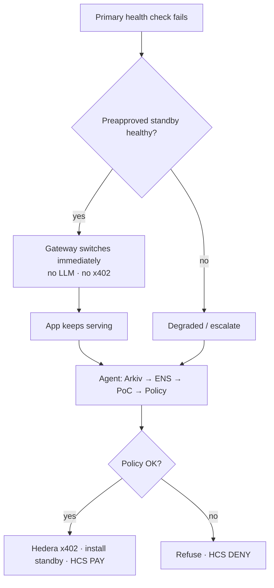

# NeverDown

### The Autonomous Resilience Operator for Web3

**ETHGlobal Mumbai 2026** · Repo: [github.com/dhanushonchain/NeverDown](https://github.com/dhanushonchain/NeverDown)

> When existing providers can’t supply what you need, NeverDown discovers, verifies, purchases, and activates a replacement — under an enforceable resilience policy — and proves every step.

NeverDown is a B2B ops layer for live dApps: **monitor → investigate → procure → recover → verify → audit**, inside explicit spend and action limits.

It is **not** a chatbot that “tries to fix prod.”  
It is **programmable application resilience** with a fast failover plane and an autonomous procurement plane.

---

## Docs map

| Doc | What’s inside |
|---|---|
| **This README** | Product, prizes, demo, status, quick start |
| **[docs/BUILD-CHUNKS.md](docs/BUILD-CHUNKS.md)** | **Detailed C0→C10 steps, gates, file ownership** |
| **[docs/neverdown-architecture.md](docs/neverdown-architecture.md)** | Planes, components, flows, security honesty |
| **[docs/neverdown-architecture.excalidraw](docs/neverdown-architecture.excalidraw)** | Editable architecture diagram |

---

## Problem

Small DeFi / wallet / infra teams cannot run 24/7 ops. At 3 AM: RPC dies, indexer lags, price API fails, treasury looks weird.

| What exists today | Gap |
|---|---|
| Monitoring / AI-SRE (alerts, guided remediation) | Doesn’t **buy** new capacity |
| RPC gateways (preconfigured failover) | Doesn’t **discover + pay** for a new provider |
| Agent wallets (spend caps) | Rarely unify **payment + operational** permissions |

**NeverDown’s wedge:** vendor-independent **service acquisition** under policy — then install as standby and leave an evidence trail.

---

## How it works (simple)

1. You connect a dApp and define a **Resilience Contract** (budget, allowlisted sellers, allowed actions).  
2. Traffic goes through the **NeverDown gateway** (data plane).  
3. If primary RPC fails → gateway switches to a **preapproved standby** instantly (no AI, no payment).  
4. The **Supreme Agent** then finds a replacement on **Arkiv**, checks **ENS** identity, runs **Proof-of-Capability**, pays with **Hedera x402** if policy allows, and installs a new standby.  
5. If the agent tries an unapproved seller or goes over budget → **refuse before sign** → **HCS DENY**.  
6. Dashboard shows HashScan, Arkiv entity, ENS name, and HCS receipts.

---

## Two planes (most important diagram)



Full architecture: [docs/neverdown-architecture.md](docs/neverdown-architecture.md).

---

## Breakthrough features (product)

| Feature | One-line |
|---|---|
| **Resilience Contract** | Machine-enforceable budget, allowlist, and allowed actions (not unlimited admin) |
| **Dependency Graph** | Know which failures are critical vs noise (manifest-first for hackathon) |
| **Recovery before procurement** | Fast plane failover; agent replenishes capacity afterward |
| **Capability marketplace** | Arkiv offers for RPC / intel — not a generic agent bazaar |
| **Proof-of-Capability** | Live-test a provider before activate |
| **Evidence Ledger** | HCS-anchored receipts + HashScan — independently checkable |
| **Bounded autonomy** | Observe / Recover / Privileged (human) |

---

## Prize stack

| # | Sponsor | Exact bounty | NeverDown use |
|---|---|---|---|
| 1 | **Hedera** | [AI Agents That Pay: x402](https://ethglobal.com/events/mumbai/prizes/hedera) ($6.5k) | Autopay RPC packs; budgets; HCS audit; HashScan proof |
| 2 | **Arkiv** | [Build on Arkiv (from scratch)](https://ethglobal.com/events/mumbai/prizes/arkiv) ($4k) | Expiring wallet-owned capability offers the agent queries |
| 3 | **ENS** | [Best Use of ENSv2](https://ethglobal.com/events/mumbai/prizes/ens) ($7k) | Seller/agent namespaces + text records gate the allowlist |

**Secondary (same app):** Hedera [No Solidity Allowed](https://ethglobal.com/events/mumbai/prizes/hedera) — SDK + HCS + accounts, zero Solidity.

**Skipped for MVP:** ATS/Stablecoin, Continuity, Swarm, Arc, 0G.

### Qualification we must hit

**Hedera x402**

- x402-protected endpoint on Hedera testnet via Official / Ax402 / Blocky402  
- Agent/client pays end-to-end with **no human approving**  
- README: setup, architecture, payment flow, **settled tx ID** + HashScan  
- Demo video ≤5 min  

**Extra points we target:** budgets, merchant allowlist, HCS spending audit.

**Arkiv**

- Write + **read** with `@arkiv-network/sdk` (not log-only)  
- README: writer wallet + one query  
- `/arkiv/schema.md`, `friction.md`, `reach.md`, `why-arkiv.md`, `how-you-use-arkiv.md`  

**ENSv2**

- Live resolve on Sepolia or mainnet — **central** to allowlist, not cosmetic  
- Demo + open source  

---

## Hackathon MVP: Self-Healing RPC Gateway

One demo app · three providers · one agent · one Resilience Contract.

| Act | What judges see |
|---|---|
| 1 | Healthy RPC through NeverDown gateway |
| 2 | Kill primary → standby restores (fast plane) |
| 3 | Agent discovers Arkiv offer → ENS → PoC → real x402 pay → new standby |
| 4 | Malicious / over-cap attempt → policy DENY before sign |
| 5 | Evidence: HashScan + Arkiv + ENS + HCS |

We run our **own** x402 RPC merchant to show the market mechanism — not claim a mature public x402 RPC market already exists.

**Stretch (after MVP):** wallet investigation tool → Guardian Drills → real contract analyzers.

---

## Build plan (chunked — do not boil the ocean)

We build **small chunks with hard gates**. Details for every step:

👉 **[docs/BUILD-CHUNKS.md](docs/BUILD-CHUNKS.md)**

| Chunk | Deliverable | Gate |
|---|---|---|
| **C0** | Monorepo scaffold | `pnpm install` — **done** |
| C1 | Seller returns HTTP 402 | `curl` shows 402 |
| C2 | Pay on Hedera testnet | HashScan tx id |
| C3 | Policy + HCS PAY/DENY | Over-cap refuses |
| C4 | Gateway failover | Works with AI offline |
| C5 | Arkiv offers seed/query | Live query |
| C6 | ENSv2 allowlist | Fail closed |
| C7 | Proof-of-Capability | Bad RPC rejected |
| C8 | Agent wire-up | Act 3 + 4 via CLI |
| C9 | Console UI | Five-act clickable |
| C10 | Judge packaging | Ship checklist |

**Order:** rails (C1–C7) → agent (C8) → UI (C9) → packaging (C10).

---

## Repo layout

```
neverdown/
  apps/web/              # Console + demo UI          → C9
  apps/gateway/          # Fast Recovery Plane        → C4
  apps/sellers/          # x402 RPC merchant          → C1
  packages/core/         # Policy, agent, rails       → C2–C8
  docs/                  # Architecture + build guide
  arkiv/                 # Judge markdown             → C5 / C10
  .env.example
  LICENSE                # MIT
```

---

## Quick start (C0)

```bash
git clone https://github.com/ujjwaldubey1/NeverDown.git
cd NeverDown
cp .env.example .env

# Node 20+
npx pnpm@9.15.0 install
npx pnpm@9.15.0 -r list --depth -1
```

Fill `.env` before C1/C2 (Hedera, facilitator, later Arkiv/ENS). **Never commit `.env`.**

---

## Stack

| Layer | Choice |
|---|---|
| Monorepo | pnpm workspaces + TypeScript |
| Console | Next.js (C9) |
| Gateway | Node JSON-RPC proxy (C4) |
| Payments | `@x402/hedera` exact · `cryptoTransfer` |
| Discovery | `@arkiv-network/sdk` |
| Identity | ENSv2 (Sepolia/mainnet) |
| Audit | HCS + Mirror REST + HashScan |
| Agent | Tool loop (Vercel AI SDK / OpenAI-compatible) |

**Security honesty:** MVP = cap-funded spend wallet + server PolicyEngine + `cryptoTransfer`. We do **not** claim a stolen unrestricted key cannot spend. `transferExecutor` is later.

---

## What NeverDown is not

- Not a generic agent marketplace  
- Not unlimited production admin  
- Not a guarantee of any availability %  
- Not LLM-invented risk without chain evidence  
- Not Arc / 0G as primary prize rails for this build  

---

## Status

| Item | State |
|---|---|
| Product vision | Locked |
| Brand | **NeverDown** |
| C0 scaffold | **Done** |
| C1–C10 | Not started |
| Git remote | `https://github.com/dhanushonchain/NeverDown.git` |

Built for **ETHGlobal Mumbai 2026**.
