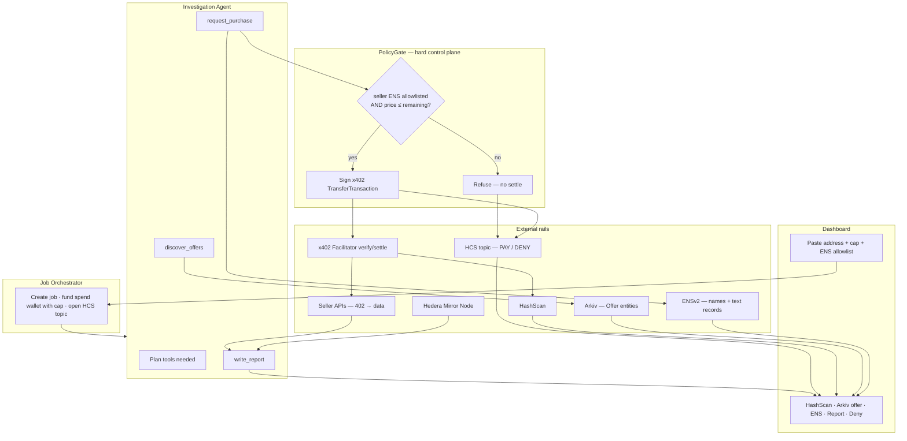
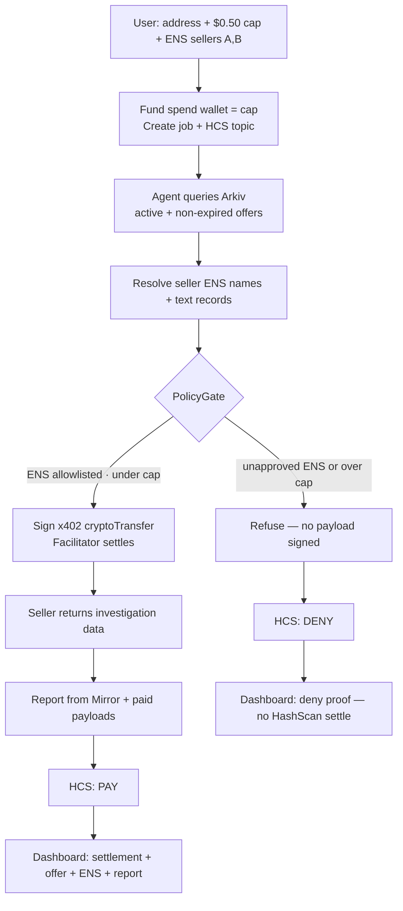
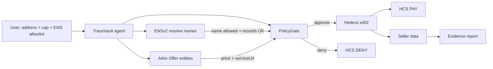
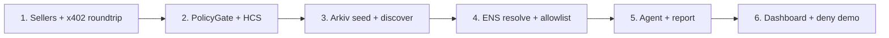

# TraceVault

**ETHGlobal Mumbai 2026** — AI wallet-investigation agent that buys paid data tools on its own, inside a hard spend limit and an allowlist of sellers.

> Our agent finds paid investigation tools without a centralized directory, pays autonomously, does useful work, and a stolen key still can’t drain the budget or pay an unapproved seller.

---

## What it is (simple)

TraceVault is a private-investigator agent for suspicious wallets.

1. You paste a **suspicious address**
2. You set a **spend cap** (e.g. `$0.50`)
3. You set an **allowlist** of approved sellers (ENS names)
4. The agent finds tools on **Arkiv**, pays with **Hedera x402**, gathers evidence, writes a short report
5. If it tries an unapproved seller or goes over budget → payment is **refused** and the deny is logged on **HCS**

Most demos only show one half:

| Typical demo | What it proves | What it misses |
|---|---|---|
| Agent marketplace (AgentPay / Agent Bazaar) | Agent bought a tool | Agent couldn’t steal |
| Budget vault (Capability Descent) | Spend is limited | No useful investigation job |

**TraceVault fixes both:** a real investigation task **plus** a refuse path with on-chain deny proof.

---

## What it is not

- Not a general agent marketplace
- Not `transferExecutor` / contract settlement (cryptoTransfer x402 only for v1)
- Not World-first / Worldcoin
- Not an LLM inventing wallet risk — uses **Hedera Mirror Node** data and deterministic paid stubs

---

## Prize stack (ETHGlobal Mumbai)

| Sponsor | Target bounty | Role in TraceVault |
|---|---|---|
| **[Hedera](https://ethglobal.com/events/mumbai/prizes/hedera)** | AI Agents That Pay: x402 on Hedera ($6,500) | Money movement + audit log |
| **[Arkiv](https://ethglobal.com/events/mumbai/prizes/arkiv)** | Build on Arkiv from scratch ($4,000) | Decentralized tool discovery |
| **[ENS](https://ethglobal.com/events/mumbai/prizes/ens)** | Best Use of ENSv2 ($7,000) | Seller / agent identity + allowlist |

Secondary Hedera shot (same app): **No Solidity Allowed** — native SDK services only (HCS + accounts), no smart contracts.

We intentionally **do not** target Arc or 0G for this build (see [Why not Arc / 0G](#why-not-arc--0g)).

---

## Who handles what (and why)

| Part | Job | Why it is needed |
|---|---|---|
| **Dashboard (UI)** | Start job; show report + proofs | Human sets rules; judges see HashScan / Arkiv / ENS / HCS evidence |
| **Investigation Agent** | Picks tools, buys under policy, writes report | Does the useful work |
| **ENS (ENSv2)** | Resolves seller/agent names; allowlist identity | “Approved seller” is a real name + records, not a hardcoded string |
| **Arkiv** | Expiring, wallet-owned Offer entities | Find tools without a centralized directory |
| **PolicyGate** | Allowlist OK? Under budget? Sign or refuse | Core safety — compromised agent still can’t freely spend |
| **Hedera x402** | Settles payment when gate says yes | Autonomous pay-per-call for investigation tools |
| **HCS** | Immutable `PAY` / `DENY` messages | Proof of settle **and** proof of refuse |
| **Seller APIs** | HTTP 402 → pay → return data | Real (or deterministic stub) paid tools |
| **Mirror Node** | Free on-chain tx / token facts | Report uses chain data, not LLM guesses |

---

## Architecture



### Trust model

With `cryptoTransfer` (not `transferExecutor`), a raw stolen private key can always drain an account. TraceVault uses **two layers**:

1. **Hard:** spend wallet is funded with **exactly the job cap** at start → max loss = cap  
2. **Product:** LLM never holds the spend key; it only calls `request_purchase` → **PolicyGate** signs or refuses → off-allowlist / over-cap = **DENY on HCS before settle**

Invariant: spend private key lives only inside PolicyGate process memory / env — never in LLM context or the browser.

---

## Flowcharts

### Happy path vs compromised path



### Rail responsibilities



| Concern | Rail |
|---|---|
| Who may be paid | **ENS** allowlist + resolved records |
| What tools exist | **Arkiv** expiring offers |
| How money moves | **Hedera** x402 + HCS pay/deny |
| What the job finds | Mirror Node + paid seller payloads |

---

## Sponsor tracks — what each one does in TraceVault

### 1. Hedera — money + audit

**Bounty:** [AI Agents That Pay: x402 on Hedera](https://ethglobal.com/events/mumbai/prizes/hedera)

| Piece | What we use it for |
|---|---|
| **x402 exact / `cryptoTransfer`** | Agent pays sellers autonomously inside HTTP 402 flow (HBAR / HTS) |
| **Facilitator** | Verifies + settles; pays network fees (`feePayer`) |
| **HCS topic** | Tamper-evident log of every `PAY` and `DENY` |
| **Mirror Node** | Real wallet tx / token facts for the evidence report |
| **HashScan** | Judge-facing settlement links |

**Why Hedera fits:** their idea list literally includes a budgeted research agent, spending controls (budgets, allowlists), and HCS as an audit log — TraceVault is that product.

**Extra / secondary:** SDK-only path (no Solidity) also qualifies for **No Solidity Allowed** if we keep payments + HCS native.

---

### 2. Arkiv — discovery without a directory

**Bounty:** [Build on Arkiv (from scratch)](https://ethglobal.com/events/mumbai/prizes/arkiv)

| Piece | What we use it for |
|---|---|
| **Offer entities** | Wallet-owned listings for investigation tools |
| **SQL-like queries** | Agent finds active, non-expired offers by category |
| **Entity expiry** | Stale offers disappear — no central delist UI |
| **Explorer** | Dashboard links to the offer entity used |

**Offer fields (planned):**

| Field | Purpose |
|---|---|
| `sellerAccountId` / Arkiv owner | Must match ENS-resolved seller |
| `serviceUrl` | x402 resource endpoint |
| `priceTinybars` | Cap check |
| `category` | `tx_history` \| `token_risk` \| `counterparties` |
| `expiresAt` / TTL | Native Arkiv expiry |

Hackathon docs we will ship: `/arkiv/schema.md`, `/arkiv/friction.md`.

---

### 3. ENS — identity + allowlist

**Bounty:** [Best Use of ENSv2](https://ethglobal.com/events/mumbai/prizes/ens)

| Piece | What we use it for |
|---|---|
| **ENSv2 names / subnames** | Human-readable sellers + agent identity |
| **Text records** | Map name → Hedera account, Arkiv owner, `x402Url`, category |
| **Enhanced Access Control** | Who can edit allowlist / agent records |
| **Permissioned Resolver** | Sellers own their subname data |
| **Agent text records (ENSIP-26)** | Agent-as-namespace identity |

**Must not be cosmetic:** PolicyGate resolves live ENS and **fail-closes** if the name is off-allowlist or required records are missing.

Demo line: *Allowlist is identity, not a hardcoded string list — if the name isn’t approved, PolicyGate refuses before x402 settle.*

---

### Why not Arc / 0G

| Sponsor | Why we skip for TraceVault |
|---|---|
| **Arc** | Closest bounty wants Circle Discovery API + USDC on Arc + Arc Studio as starting point — a second marketplace and payment rail that fights Hedera + Arkiv |
| **0G** | Consumer AI / robots / “earn for 0G Compute” loops don’t match a one-shot investigation job; would dilute the x402 + PolicyGate story |

Depth on **three coherent rails** beats shallow multi-sponsor stitching.

---

## PolicyGate (single choke point)

```
remaining = job.cap - sum(successful PAY amounts)
if seller ENS ∉ allowlist (or records fail) → DENY(OFF_ALLOWLIST) → HCS → return
if offer.price > remaining → DENY(OVER_CAP) → HCS → return
if offer expired / missing on Arkiv → DENY(STALE_OFFER) → HCS → return
build PaymentRequirements from seller 402
sign with spend key via @x402/hedera ExactHederaScheme (cryptoTransfer)
facilitator verify + settle
on success: remaining -= price; HCS PAY; return data to agent
```

---

## Agent tools (minimal surface)

1. `discover_offers(category?)` → Arkiv  
2. `request_purchase(offerId)` → **only** entry to PolicyGate → ENS check → x402  
3. `get_mirror_activity(address)` → Mirror Node (free, real)  
4. `write_report()` → structured evidence from paid + mirror facts  
5. `force_bad_purchase(...)` *(demo-only)* → triggers DENY path for judges  

No general `transfer_hbar`, no unconstrained HTTP without the gate.

---

## Dashboard (proof board)

One job view, four panels:

1. **Job** — target address, cap, remaining, ENS allowlist  
2. **Settlements** — HashScan links for each PAY  
3. **Discovery + identity** — Arkiv offer entity + ENS name used  
4. **Audit** — HCS timeline with DENY highlighted  

Plus the short evidence report below.

---

## Build order



1. Seller endpoint returns 402 → pay with `@x402/hedera` → get JSON  
2. Wrap payment in PolicyGate + HCS (unit-test allowlist / over-cap)  
3. Publish Arkiv offers; query them  
4. Wire ENSv2 resolution into the gate  
5. Agent tool loop + Mirror-backed report  
6. Dashboard + one-click compromised path  

---

## Demo script (~90 seconds)

1. Paste suspicious account + `$0.50` + ENS sellers A, B  
2. Agent finds Arkiv offers, pays A, pulls data, writes report  
3. Show HashScan settle + Arkiv entity + ENS name + report  
4. Trigger off-allowlist buy → **DENY on HCS**, no settlement  
5. One-liner: useful work, autonomous pay, and a bad agent still can’t drain the budget or pay an unapproved seller  

---

## Planned repo layout

```
TraceVault/
  README.md                 # this file
  apps/web/                 # Next.js dashboard + job API
  apps/sellers/             # 2–3 x402 resource servers
  packages/core/            # PolicyGate, HCS, Arkiv types, ENS resolve, report
  scripts/seed-arkiv.ts
  arkiv/schema.md
  arkiv/friction.md
```

---

## Stack (planned)

| Layer | Choice |
|---|---|
| Web | Next.js App Router |
| Agent | Vercel AI SDK tool loop (small tool surface) |
| Payments | `@x402/hedera` exact + `cryptoTransfer` + public facilitator |
| Discovery | `@arkiv-network/sdk` Offer entities |
| Identity | ENSv2 (Sepolia or mainnet) |
| Audit | HCS `TopicMessageSubmit` + Mirror REST |
| Chain evidence | Hedera Mirror Node REST |
| Sellers | Express/Hono HTTP 402 services |

---

## Status

Architecture and prize stack locked. Implementation next.

Built for **ETHGlobal Mumbai 2026**.
