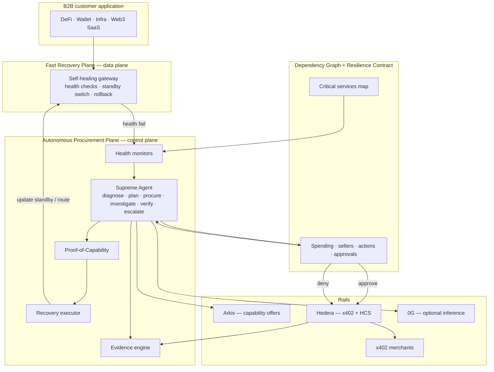
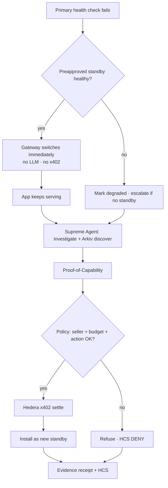
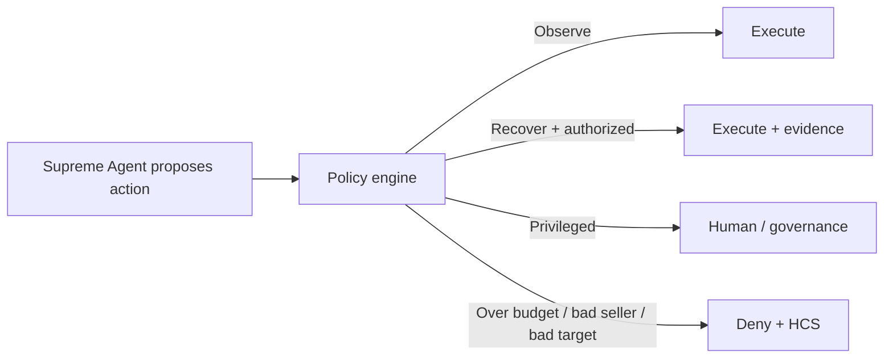

# TraceVault

### The Autonomous Resilience Operator for Web3

**ETHGlobal Mumbai 2026**

> TraceVault is a B2B operations platform that keeps Web3 applications resilient through continuous dependency monitoring, evidence-based incident investigation, policy-controlled service procurement, and automated recovery.

Companies define **what must stay operational**, **what the agent is allowed to change**, and **how much it can spend**. TraceVault prepares for failures, recovers from eligible incidents, purchases additional capabilities when needed, and produces **verifiable evidence** of every decision.

It is **not** “an AI chatbot that tries to fix things.”  
It is **programmable application resilience** with vendor-independent purchasing and bounded autonomy.

---

## One-liner for judges

> When existing providers can’t supply what you need, TraceVault discovers, verifies, purchases, and activates a replacement — under an enforceable resilience policy — and proves every step.

---

## What problem this solves

Small DeFi / wallet / infrastructure teams cannot staff 24/7 ops. At 3 AM:

- Primary RPC stops responding  
- Indexer falls behind  
- Price API dies  
- Unusual treasury activity appears  

Ordinary monitoring alerts a human. Ordinary gateways fail over to **preconfigured** backups. AI-SRE tools (Rootly, incident.io, etc.) investigate and guide remediation.

**TraceVault’s wedge:** when preconfigured capacity is exhausted or missing, the Supreme Agent **procures** a verified replacement via an open marketplace (Arkiv + Hedera x402), within spend and action limits, then replenishes standby capacity — and anchors evidence.

| Capability | Existing solutions | TraceVault opportunity |
|---|---|---|
| Incident investigation | AI-SRE tools | Web3 evidence + paid specialist tools |
| RPC failover | RPC gateways (e.g. dRPC) | Autonomous **purchase + replenishment** of capacity |
| Spending limits | Agent-wallet products | Unified **payment + operational** permissions |
| Resilience testing | Chaos engineering | Integrated with recovery **and** procurement |
| Verifiable records | Ops logs | Cross-vendor signed policy + settlement evidence |

None of those pieces alone is novel. The product is the **full vendor-independent resilience lifecycle**.

---

## Product definition

### What customers buy

Not “an AI agent.”  
A system that understands critical dependencies and is **authorized to restore service** inside explicit operational, financial, and security boundaries.

### Three jobs

| Job | Meaning |
|---|---|
| **MONITOR** | Know when something critical is wrong |
| **INVESTIGATE** | Understand impact; buy specialist data if useful; return evidence + plan |
| **RECOVER** | Switch / activate / procure under policy; verify; audit; escalate if needed |

Loop: **Detect → Diagnose → Decide → Procure → Act → Verify → Audit**  
If recovery fails → rollback where possible or escalate to a human.

---

## Breakthrough features

### 1. Resilience Contracts (programmable resilience policy)

Machine-enforceable operating agreements between the business and TraceVault — **not** necessarily on-chain smart contracts.

Example settings:

- Availability **objective** (e.g. 99.9% — a target, not a TraceVault guarantee)  
- Emergency service-purchase **budget** (e.g. `$25`)  
- Permit automated switching among **preapproved** providers  
- Never use unverified chain / endpoint  
- Never expose treasury signing keys to the AI  
- Require approval for irreversible production actions  
- Record every procurement and recovery decision  

Customer proposition: *restore service within explicit ops, money, and security bounds.*

### 2. Application Dependency Graph

Onboarding starts with an **Infrastructure Discovery Audit** (manifest-first for the hackathon):

- Connect repo / deploy config / service manifest  
- TraceVault maps critical deps (RPC, indexer, oracle, AI API, …)  
- Owner verifies and authorizes them  

Impact-aware recovery:

- Failed analytics API ≠ production-wide emergency  
- Failed settlement dependency = critical  

Hackathon scope: **simple manifest → graph → active probes**. No full production autodiscovery.

### 3. Recovery before procurement (two planes)

Applications cannot wait for LLM + marketplace + payment on every outage.

| Plane | What it does | Latency path |
|---|---|---|
| **Fast Recovery Plane** | Deterministic gateway switches to a **pretested, preauthorized** standby when health checks fail | No LLM, no blockchain tx on the request path |
| **Autonomous Procurement Plane** | Supreme Agent investigates, discovers capacity on Arkiv, Proof-of-Capability tests, pays via Hedera x402, installs a **new standby** | Restores redundancy for the *next* outage |

**Key judge line:** TraceVault does not need the AI to be fast enough to save every RPC call. The AI makes the app more resilient by **replenishing** capabilities after failure. That separates automatic routing from autonomous **service acquisition**.

### 4. Guardian Drills (chaos-to-recovery)

Staging-only resilience tests before production breaks.

Simulate (examples): RPC 503, stale blocks, indexer lag, feed disagreement, bad API payloads, x402 price change, merchant down, over-cap purchase attempt.

Measure: detection time, switch time, total recovery, unauthorized purchase refused — against the Resilience Contract.

**Production fault injection requires separate authorization.** Hackathon: staging / simulated drills only.

### 5. Recovery Capability Marketplace (not a generic agent bazaar)

Arkiv listings are **operational capabilities**, machine-purchasable:

| Capability | Example purchase | When useful |
|---|---|---|
| RPC access | Temporary JSON-RPC package | Primary capacity exhausted |
| Indexing | Historical event retrieval | Lag / gaps |
| Tx simulation | Simulate suspicious tx | Incident investigation |
| Wallet intelligence | Counterparties / token flows | Treasury threat |
| Contract analysis | Static analysis | Dangerous contracts |
| AI inference | Extra model calls | Complex classification |
| Log analysis | On-demand diagnostics | Unclear failures |

Offer metadata (beyond price): seller identity, payTo, chains/methods, expiry, rate limits, compatibility, test/conformance profile, seller-signed metadata.

**Arkiv** = discovery. **Hedera** = settlement.  
Listings are not trust: anyone can publish entities — see Proof-of-Capability.

### 6. Proof-of-Capability

Before activating an unfamiliar provider (RPC example):

1. Confirm chain ID  
2. Compare block height vs independent source  
3. Probe required JSON-RPC methods  
4. Check error behavior / consistency  
5. Measure latency  
6. Confirm x402 `payTo` matches approved seller  
7. Activate only if required tests pass  

Select on **current capability**, not reputation alone.

### 7. Evidence Ledger

Every autonomous action yields a structured **Recovery Evidence Receipt**, HCS-anchored:

- Incident id + detection evidence  
- Decision + policy version  
- Authorization outcome  
- Hedera settlement tx (if any)  
- Post-action verification results  
- Signed / hashed record  

Independently checkable: signatures, policy version, HashScan settlement, evidence hashes — without trusting the TraceVault UI.

**Honesty bound:** a receipt proves those observations/decisions were recorded; it does **not** prove global health for every user or that nothing unlogged occurred. Separate agent claims from independently verified facts.

### 8. Bounded Autonomy (enterprise-safe)

| Level | Examples | Execution |
|---|---|---|
| **Observe** | Logs, code inspect, wallet analysis | Automatic |
| **Recover** | Switch approved RPC routes, buy bounded API packs, activate verified backups | Automatic under policy |
| **Privileged** | Pause contracts, revoke permissions, deploy, move treasury | Human / governance only |

Two security boundaries (both required):

1. **Financial** — no over-budget / off-allowlist payments  
2. **Operational** — no unauthorized infra changes, credential leaks, or unsafe actions  

Perfect payment limits do **not** protect against unrestricted K8s/cloud credentials. Policy covers **both** payment and infrastructure permissions from day one.

---

## Architecture



**Invariant:** if AI, Arkiv, or Hedera is down, the **data plane keeps serving** last-known-good routes. TraceVault must not become the single point of failure it was built to eliminate.

---

## Who handles what

| Component | Responsibility |
|---|---|
| **Customer console** | Resilience Contract, dependency graph, budgets, allowlists, evidence UI |
| **Dependency Graph** | What is critical; impact of each failure |
| **Fast Recovery Plane (gateway)** | Instant switch to preapproved standby |
| **Supreme Agent** | Diagnose, plan, procure, investigate, verify, escalate |
| **Policy / Permission layer** | Enforce spend + allowed sellers + allowed actions |
| **Arkiv** | Time-limited, wallet-owned capability offers |
| **Hedera x402** | Autonomous settlement for purchased capacity / intel |
| **HCS** | Ordered, tamper-evident PAY / DENY / decision anchors |
| **0G Private Computer** | Optional inference for plan selection + explanations (request IDs) |
| **Proof-of-Capability** | Live verify before activate |
| **Evidence Engine** | Signed receipts + dashboard + independent verify path |
| **Recovery Executor** | Safe switch / rollback only for authorized targets |

---

## Prize stack (ETHGlobal Mumbai)

| Sponsor | Track | Role in TraceVault |
|---|---|---|
| **[Hedera](https://ethglobal.com/events/mumbai/prizes/hedera)** | AI Agents That Pay: x402 | Buy replacement RPC / intel; HCS evidence; HashScan proof |
| **[Arkiv](https://ethglobal.com/events/mumbai/prizes/arkiv)** | Build on Arkiv | Wallet-owned, expiring **capability** offers the agent queries |
| **[0G](https://ethglobal.com/events/mumbai/prizes)** | Private Computer | Incident reasoning + explanations with real request IDs |

Payment security path for MVP:

- **Hackathon-fast:** isolated signer, server-side policy, cap-funded wallet, `cryptoTransfer`  
- **Stronger later:** `transferExecutor` spend policies (if facilitator supports)  

**Do not claim** an unrestricted stolen payer key cannot spend its funds. Production claims must match cryptographic enforcement.

---

## Hackathon build: Self-Healing RPC Gateway

Long-term vision is large. The submission is one sharp demo:

### TraceVault: The Self-Healing RPC Gateway

One app · three providers · one Supreme Agent · one Resilience Contract.

#### Five-act live demo

1. **Healthy** — Demo dApp makes Ethereum testnet RPC calls through TraceVault gateway  
2. **Primary fails** — Inject outage → **preapproved fallback** restores service automatically (fast plane)  
3. **Agent replenishes** — Discovers eligible replacement on **Arkiv**, Proof-of-Capability, real **Hedera x402** purchase, installs as new standby  
4. **Attack / abuse** — Malicious listing redirects `payTo` or exceeds budget → **policy refuses** before sign  
5. **Proof** — Dashboard: recovery metrics, provider tests, HashScan tx, Arkiv entity, HCS-anchored receipts  

We run our own x402 RPC merchant to demonstrate the market mechanism — not claim a mature public x402 RPC marketplace already exists.

#### Stretch (in order)

1. Wallet investigation via purchased chain-data tools  
2. Staging-only Guardian Drill  
3. Defer generalized contract auditing until real analyzers exist  

#### Failure tests before recording the demo

1. Stale-but-responsive RPC  
2. Invalid chain ID  
3. Concurrent purchases that jointly exceed budget  
4. Hedera / Arkiv control plane unavailable (data plane still serves)  

---

## Flowcharts

### Fast recovery vs procurement



### Bounded autonomy



---

## Planned stack

| Layer | Choice |
|---|---|
| Console | Next.js |
| Gateway (data plane) | Node proxy — health, routes, rollback |
| Agent | Tool loop; optional **0G** inference |
| Discovery | `@arkiv-network/sdk` capability offers |
| Payments | `@x402/hedera` exact + `cryptoTransfer` |
| Audit | HCS + Mirror REST + HashScan links |
| Merchants | Our x402 RPC pack (+ intel stub for stretch) |
| Evidence | Signed receipts + HCS anchors |

### Planned repo layout

```
TraceVault/
  README.md
  apps/web/              # B2B console — policy, graph, incidents, evidence
  apps/gateway/          # Fast Recovery Plane
  apps/sellers/          # x402 RPC (+ intel) merchants
  packages/core/         # Policy, agent tools, Arkiv, HCS, x402, PoC, evidence
  arkiv/schema.md
  arkiv/friction.md
```

---

## What TraceVault is not

- Not a generic agent marketplace  
- Not “AI invents wallet risk” without chain evidence  
- Not unlimited production admin  
- Not a guarantee of any availability percentage  
- Not a claim that listings or receipts prove absolute honesty or global uptime  
- Not Arc Studio / ENS as primary rails for this build  

---

## Positioning

**TraceVault — The Autonomous Resilience Operator for Web3.**

An always-on operator that monitors dApp dependencies, investigates incidents, autonomously purchases verified replacement capacity, executes authorized recovery, and publishes independently checkable evidence — without unlimited spending or production privileges.

**Build next:** Dependency Graph + Resilience Contract + Self-Healing RPC Gateway.  
Then wallet investigation, Guardian Drills, and further modules attach to the same Supreme Agent.

---

## Status

Product vision and architecture locked as **TraceVault 2.0**.  
Hackathon MVP: **Self-Healing RPC Gateway** five-act demo.

Built for **ETHGlobal Mumbai 2026**.
