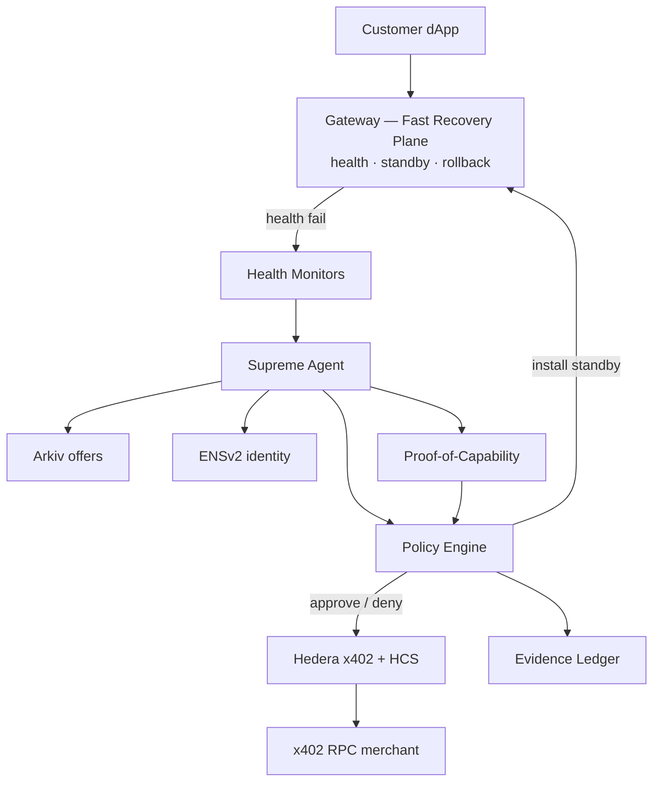
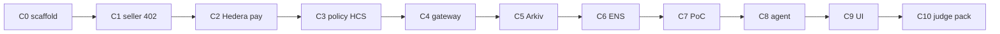

# NeverDown architecture + chunk build

> Open the native diagram: [neverdown-architecture.excalidraw](./neverdown-architecture.excalidraw)  
> (excalidraw.com or the VS Code Excalidraw extension). Mermaid below is the same content.

---

## System architecture

**Green path (data plane):** dApp → Gateway. Survives AI / Arkiv / Hedera outage.  
**Purple path (control plane):** Monitor → Agent → discover/verify/pay → replenish standby.

---

## Build in small chunks (do not build all at once)

| Chunk | Build only this | Gate before next |
|---|---|---|
| C0 | Monorepo empty shells + `.env.example` | `pnpm i` works |
| C1 | Seller returns HTTP 402 | `curl` shows 402 |
| C2 | Pay script settles on Hedera | HashScan tx id |
| C3 | Policy allow/deny + HCS | Over-cap refuses; PAY logged |
| C4 | Gateway failover | Kill primary → standby works |
| C5 | Arkiv seed + query | Live offer query |
| C6 | ENSv2 resolve | Off-allowlist fails closed |
| C7 | Proof-of-Capability | Bad RPC fails; good passes |
| C8 | Wire agent tools | Act 3 + Act 4 without UI |
| C9 | Console five-act | Clickable demo |
| C10 | README + arkiv md + video list | Ship checklist |

**Rule:** rails first (C1–C7) → agent (C8) → UI last (C9) → judge pack (C10).
