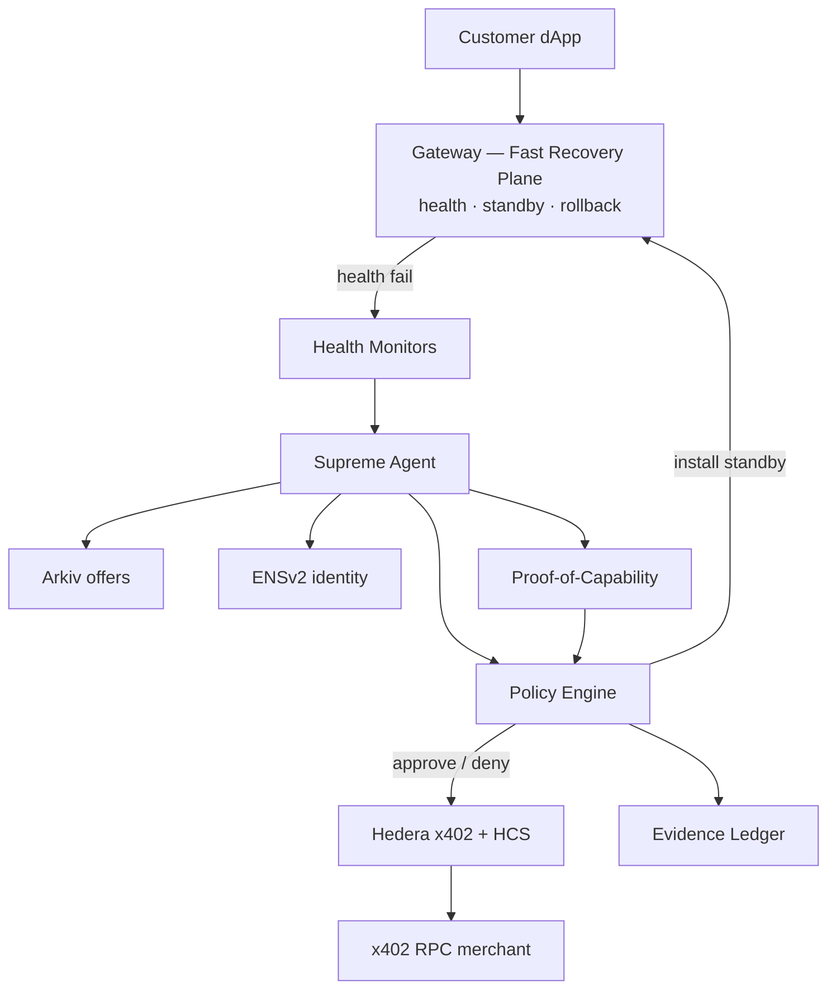
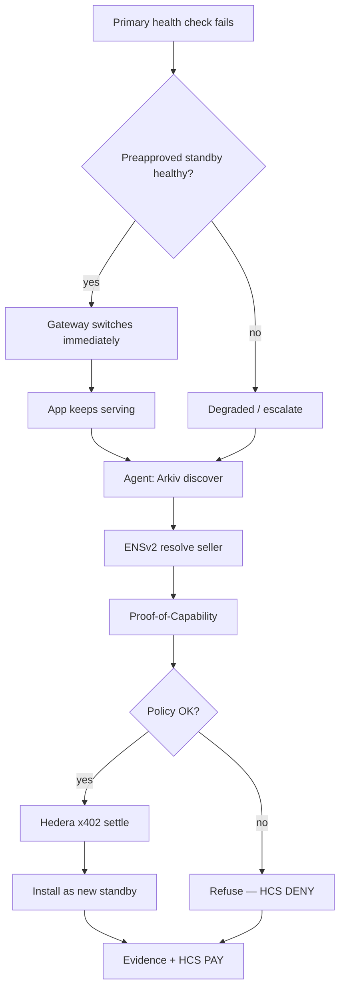
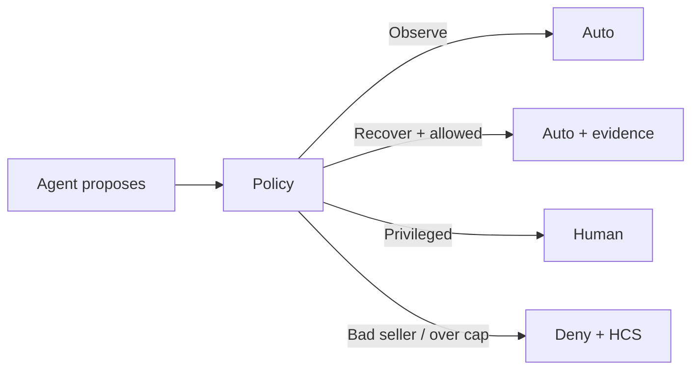
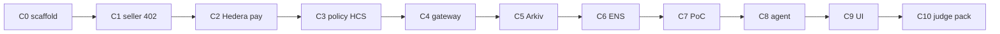

# NeverDown — architecture reference

Open the editable diagram: **[neverdown-architecture.excalidraw](./neverdown-architecture.excalidraw)**  
(excalidraw.com or the VS Code Excalidraw extension).

Chunk-by-chunk implementation: **[BUILD-CHUNKS.md](./BUILD-CHUNKS.md)**  
Product overview: **[../README.md](../README.md)**

---

## What NeverDown is

NeverDown is the **autonomous resilience operator** for Web3 apps.

Customers define:

1. What must stay up (dependency graph)  
2. What the agent may change (operational permissions)  
3. How much it may spend (financial policy)  

NeverDown then **monitors**, **investigates**, **procures** replacement capacity when needed, **recovers**, and **proves** every decision.

It is **not** “an AI that SSHes into prod and hopes.”  
It is **programmable resilience** with two planes and a hard policy gate.

---

## Core principle: recovery before procurement

| Plane | Job | Speed | Depends on AI / x402? |
|---|---|---|---|
| **Fast Recovery (data plane)** | Switch to a **pretested, preapproved** standby when health checks fail | Milliseconds–seconds | **No** |
| **Procurement (control plane)** | Discover → verify → pay → install a **new** standby after an incident | Seconds–minutes | **Yes** |

Judges should hear:

> We do not need the LLM to save every RPC request. The agent **replenishes** redundancy so the next failure is cheap.

If Arkiv, Hedera, or the LLM is down, the gateway must keep serving **last-known-good** routes.

---

## System architecture

### Component responsibilities

| Box | Owns | Must never |
|---|---|---|
| **Gateway** | Proxy JSON-RPC; health; standby switch; rollback config | Call LLM or wait on x402 per request |
| **Health monitors** | Detect timeouts, stale blocks, wrong chainId | Auto-purchase |
| **Supreme Agent** | Plan tools: discover, resolve, PoC, purchase, install | Hold spend keys or “run any shell” |
| **Arkiv** | Expiring, wallet-owned capability offers | Be treated as proof of honesty |
| **ENSv2** | Seller/agent names + text records for allowlist | Be a cosmetic label only |
| **Proof-of-Capability** | Live verify candidate RPC/service | Activate on reputation alone |
| **Policy Engine** | Budget, allowlist, payTo match, action level | Be bypassable by the LLM |
| **Hedera x402** | Settle approved purchases | Sign without policy |
| **HCS** | Ordered PAY / DENY / decision messages | Replace independent HashScan checks |
| **Evidence Ledger** | Receipts linking policy version + tx + checks | Claim global uptime proof |

---

## Happy path vs deny path

---

## Bounded autonomy

| Level | Examples | Mode |
|---|---|---|
| Observe | Read health, Mirror data, offer lists | Automatic |
| Recover | Switch approved routes, buy under cap, install verified standby | Automatic under policy |
| Privileged | Pause contracts, move treasury, change cloud IAM | Human / governance |

**Financial boundary:** budget + allowlist + payTo.  
**Operational boundary:** only authorized gateway targets — no freeform prod credentials for the LLM.

---

## Sponsor rails (what goes where)

| Concern | Rail | Prize track |
|---|---|---|
| Who may be paid | **ENSv2** names + text records | Best Use of ENSv2 |
| What can be bought | **Arkiv** expiring offers | Build on Arkiv |
| How money moves + audit | **Hedera** x402 + HCS | AI Agents That Pay; No Solidity secondary |
| How we prove it | HashScan + Arkiv explorer + ENS + Mirror topic | Demo / README |

---

## Chunk build order

Full step lists, gates, and file ownership: **[BUILD-CHUNKS.md](./BUILD-CHUNKS.md)**.

**Rails first → agent → UI last.** Never skip gates.

---

## Security honesty

MVP uses:

- Cap-funded spend wallet  
- Server-side PolicyEngine  
- Hedera x402 `cryptoTransfer`  

We **do not** claim a stolen unrestricted private key cannot spend. Stronger `transferExecutor` policies are post-hackathon if facilitators support them.

---

## Demo mapping (five acts)

| Act | Plane | Chunks proving it |
|---|---|---|
| 1 Healthy | Data | C4 + C9 |
| 2 Primary fails → standby | Data | C4 |
| 3 Procure new standby | Control | C5–C8 + C2 |
| 4 Deny bad spend | Policy | C3 + C6 |
| 5 Evidence board | Audit | C3 + C9 + C10 |
